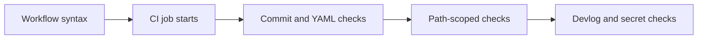

# CI and Runtime Troubleshooting

## Goal
Provide durable symptom-to-fix guidance for the process-scaffold failures that future MiniShop pull requests could repeat.

## Prerequisites
- Access to the pull request’s `ci` check and its failed-step logs.
- [Git workflow](./process/git-workflow.md) for the expected delivery sequence.

## Key Concepts
| Concept | Plain-language explanation |
|---|---|
| Job creation | A workflow syntax failure can stop GitHub Actions before any job exists. |
| Synthetic merge commit | GitHub can create a temporary merge ref for a PR; commitlint should check the actual branch commits instead. |
| Hosted runner | A runner image is not a contract that every convenience tool is installed. |
| Git ref write denial | A filesystem sandbox can block local branch creation even when the repository worktree is writable. |
| Runtime credential guard | A bootstrap script can stop before creating a Secret when a required runtime input is absent. |
| Dynamic ShellCheck source | A dynamically resolved shell helper may need an explicit source directive or scoped suppression. |
| GHCR package access | Package visibility and repository access permissions need verification after first publication. |
| NetworkPolicy enforcement | A cluster may accept NetworkPolicy objects without enforcing them if its CNI does not implement policy enforcement. |
| HPA selector overlap | A workload can match more than one HPA selector, making scaling ambiguous even when resource names differ. |
| Kustomize source paths | A base that reuses manifests outside its directory needs an explicit load-restriction choice. |
| Overlay replica targets | An HPA may set a live replica count above the replica value rendered by an overlay. |
| Kind runtime recovery | A transient container-runtime sandbox failure can leave a workload Pod Pending during a Helm reinstall. |
| Application database authentication | An HTTP-success response can still carry a database error instead of application data. |

## Architecture / Flow
A pull request first loads its workflow, then starts the `ci` job, then runs each validation step.



## Implementation Walkthrough
1. **Record workflow bootstrap failures**: capture the exact failure class before changing CI.
   - File(s): `.github/workflows/ci.yml`
   - A run with no job generally indicates a workflow-loading issue rather than a failed step.
2. **Use portable, pinned checks**: configuration belongs in the repository; runner tools are used only when explicitly available.
   - File(s): `.commitlintrc.json`, `.github/workflows/ci.yml`
   - The remediation pins kubeconform and PSScriptAnalyzer, collects PowerShell findings before failing, and replaces `rg` with `grep -E`.

## Run & Verify
```bash
# Open the failed `ci` run and identify whether a job was created.
# Read the named failed step before changing the workflow.
```
Expected result: the diagnosis identifies the failing layer and the next run advances beyond that layer. The clean-history remediation PR #7 completed successfully in GitHub Actions run `36256218460`; the earlier PR #6 run remains historical troubleshooting evidence.

## Common Pitfalls
- **Symptom:** A workflow run fails before any job begins. **Cause:** workflow YAML or expression syntax is invalid. **Fix:** correct the reported line, then confirm the next run creates `ci`.
- **Symptom:** Commitlint reports `empty-rules`. **Cause:** the CLI has no repository rule configuration. **Fix:** add and version a commitlint configuration, then lint the actual PR commit range.
- **Symptom:** Commitlint rejects a subject containing uppercase letters. **Cause:** repository policy requires a lowercase subject. **Fix:** use lowercase words and acronyms in the Conventional Commit subject.
- **Symptom:** Yamllint reports document-start, truthy-key, or line-length violations. **Cause:** the workflow does not meet the repository’s lint policy. **Fix:** make the YAML conform exactly and rerun the pinned linter.
- **Symptom:** CI cannot find `rg`. **Cause:** ripgrep is not guaranteed on a hosted runner. **Fix:** use `grep -E` for this simple changed-path filter or provision the dependency explicitly.
- **Symptom:** A local Git branch command reports a read-only ref filesystem. **Cause:** not recorded; the command could not write under `.git/refs`. **Fix:** report the exact command and obtain owner authorization before using an approved remote fallback; do not bypass the denial.
- **Symptom:** A local-path PVC remains unbound before a consumer Pod is scheduled. **Cause:** the configured `StorageClass` uses `WaitForFirstConsumer` to select a node before creating node-local storage. **Fix:** create or schedule the consumer Pod, then inspect the PVC and provisioner rollout.
- **Symptom:** A pinned containerized linter image cannot be pulled. **Cause:** the selected image tag does not exist. **Fix:** use an available, explicitly versioned image tag and record it in the validation evidence; do not install a host tool as a substitute.
- **Symptom:** The runtime credential script exits before creating the data Secret. **Cause:** one or both required runtime password inputs are absent. **Fix:** supply both required values through the deployer's runtime environment, then rerun the script; never add those values to tracked files.
- **Symptom:** ShellCheck reports `SC1091` for a helper sourced through a computed path. **Cause:** static analysis cannot resolve that dynamic source path. **Fix:** add a precise source directive when possible, or use a scoped suppression only for the dynamic source after validating the helper locally.
- **Symptom:** A fresh cluster cannot pull the published backend image. **Cause:** Package visibility or repository access permissions do not allow the intended consumers. **Fix:** verify both settings after the first protected-main publication and adjust only when needed; the workflow does not change package access.
- **Symptom:** A denied-path probe still reaches a selected Pod after NetworkPolicies apply. **Cause:** the active CNI may not enforce Kubernetes NetworkPolicy; this occurred with the local Kind `kindnet` cluster. **Fix:** verify which CNI is active and test enforcement on a policy-capable CNI before treating a successful API apply as proof that traffic is denied.
- **Symptom:** An HPA reports `AmbiguousSelector` or fails to calculate metrics for its target. **Cause:** its target Pods also match another HPA's selector; distinct HPA and Deployment names do not prevent selector overlap. **Fix:** compare each HPA target's Deployment selector and selected Pod labels, then give the new workload a disjoint selector and align its Service, NetworkPolicy, and ServiceMonitor selectors. Changing a Deployment selector is immutable; plan a controlled recreation of only that Deployment and verify legacy workloads remain unchanged.
- **Symptom:** The platform deploy script stops with `Missing required command: helm`. **Cause:** Helm is not available on the host `PATH`; `scripts/deploy-platform.sh` requires both `helm` and `kubectl`. **Fix:** use an approved pinned Helm version or provide a documented containerized invocation, then run the full script and verify the existing release is preserved. Testing chart operations in a container does not by itself validate the complete script end to end.
- **Symptom:** Kustomize cannot load canonical manifests referenced outside the base directory. **Cause:** the default `LoadRestrictionsRootOnly` disallows files outside the Kustomization root. **Fix:** when references are explicit local repository files and no plugins or remote sources are involved, render with `--load-restrictor LoadRestrictionsNone`; validate the output before applying it.
- **Symptom:** A dev overlay renders one backend replica but the running Deployment has more. **Cause:** an active HPA can override the Deployment's requested replica count to satisfy its minimum. **Fix:** inspect the target HPA's `minReplicas` and status, then distinguish the overlay's desired value from the live count; do not disable or modify the HPA implicitly.
- **Symptom:** A Helm reinstall is delayed by a Pending Pod during a transient Kind/containerd sandbox issue. **Cause:** not recorded. **Fix:** inspect Pod status/events and wait for the workload to recover; do not restart a node by default. If one non-running Pod remains after recovery, confirm it belongs to the Helm-managed controller before deleting only that Pod, then verify its replacement and all workload rollouts become Ready.
- **Symptom:** `GET /items?q=` returns HTTP 200 but the response contains
  PostgreSQL error code `28P01` instead of item data. **Cause:** the response
  reports a database authentication failure. In the case Issue #32 recorded, the
  PostgreSQL password was persisted in the PVC, so later Secret changes did not
  apply to the existing role. **Fix:** treat the endpoint as unsuccessful for
  data-path validation, avoid displaying credential values or database records,
  and ask the credential owner to align the role password. Do not delete the PVC
  or alter credentials outside an approved scope. The owner resolved this case
  during Issue #36; the exact steps are not recorded.
- **Symptom:** `GET /items?q=` returns HTTP 500 with code `42P01`, and the
  reviews route returns an empty object. **Cause:** the `marketitems` table and
  Redis keys were never seeded. **Fix:** since #40 neither the validator nor
  the backend seeds; `validate-app.sh` fails on this form with a hint to use
  the seed Job and sends no POST. With a backend pin that contains `seed.js`,
  follow the operator guide's "Seeding an empty database" steps (back up with
  `scripts/backup-data.sh` from PR #54, enable `seed.enabled` locally, deploy,
  wait for the Job, revert and redeploy); it loads 100 rows and 100 keys. Images older than #39 answered
  200 with `42P01`, which means an old image is still deployed.
- **Symptom:** `validate-app.sh` prints `WARNING: backend Pod(s) ... run a
  pre-#40 image that still serves the destructive POST /upload` and ends with
  `POST /upload probe skipped`, but exits 0. **Cause:** a guard added in #40.
  The validator sends `POST /upload` to prove the route is gone, and a pre-#40
  image would drop and reseed the table. So it skips that probe when any
  backend container (including one mid-rollout) lacks `/usr/src/app/seed.js`
  or runs a pre-#40 published digest (`e87390d3...`, `44a87d71...`,
  `599480a8...`, `f10f726b...`). This is expected until the cluster runs the
  #40 pin (`b0c282b0...`). **Fix:** deploy from `main` and wait for the rollout to finish; the
  next run sends the probe and requires 404.
- **Symptom:** `validate-app.sh` exits 1 with `Backend Pod ... requests image
  "..."` or `Backend Pod ... image "..."`, then `not a pinned MiniShop backend
  image`, or with `Could not check backend Pod ... for seed.js`, or `No backend
  Pod reports a container`. **Cause:** a backend container requests or runs
  something other than an anchored
  `ghcr.io/thanhdu-hcmus/minishop-backend@sha256:<64 hex>` image (a tag, another
  registry, or a container not yet started, which has no image ID),
  `kubectl exec` into it failed, or no backend Pod exists. **Fix:** find the Pod with `kubectl -n webapp get pods
  -l app.kubernetes.io/component=minishop-backend -o wide`, wait for the
  rollout, and deploy only the pinned chart image. Do not bypass the guard.
- **Symptom:** the first one to three seed Job Pods (`-l
  app.kubernetes.io/component=seed`) fail with `ECONNREFUSED` from PostgreSQL
  or Redis on a fresh install. **Cause:** the Job starts with the release,
  before the data services accept connections. On a throwaway cluster in #40,
  attempts 1-2 failed on PostgreSQL and attempt 3 inserted the rows, then
  failed on Redis; the next attempt skipped PostgreSQL and wrote the keys.
  **Fix:** none needed; it retries up to `backoffLimit: 6` within 900 s
  (raised from 5 after a fresh install used 4 attempts). If it exhausts them,
  check the data services and that NetworkPolicy `minishop-seed` exists;
  without it the Job timed out under default-deny. `kubectl logs job/...` picks
  an arbitrary Pod, so read the logs of a specific Pod. Do not enable the seed
  while the chart pins an image older than #40; those images have no `seed.js`.
- **Symptom (historical, images before `sha256:44a87d71...d7af`):**
  `POST /upload` crashed the backend container with a `TypeError` such as
  `"arguments[1]" must be of type "string | Buffer"`. **Cause:** node-redis
  6.2.1 rejected numeric keys. **Fix:** fixed in #43 by converting keys with
  `String(...)`; deploy the current pin.
- **Symptom (historical, images before #39):** the backend exited with code 255
  and logged `error on postgresql pool` after PostgreSQL stopped, or an upload
  waited about 64-67 s when the Redis host no longer resolved. **Cause:**
  `pool.on("error")` called `process.exit(-1)`, and Redis waits were unbounded.
  **Fix:** fixed in #39; the handler now logs `idle postgresql client error; the
  pool discarded it` and Redis waits are bounded to about 2 s. Deploy the current
  pin.
- **Symptom:** `/items` or the reviews route (or, on images before #40,
  `POST /upload`) returns 503 or 500
  with a JSON body such as `{"error":"Items query failed","code":"57P01"}`, or
  backend Pods turn unready. **Cause:** 503 means PostgreSQL or Redis is
  unreachable, refusing service (for example a wrong password), or timed out; 500
  is any other failure, such as `42P01` before seeding. `code` appears only for a
  PostgreSQL SQLSTATE. The readiness probe calls `GET /ready`, so a dependency
  outage removes every Pod from the Service. **Fix:** check the dependency and
  `GET /ready`, which names the failing check; `GET /live` stays 200 and Pods are
  not restarted. Waits are bounded by `REDIS_CONNECT_TIMEOUT_MS` (2000 ms),
  `REDIS_COMMAND_TIMEOUT_MS` (2000 ms), `POSTGRES_QUERY_TIMEOUT` (5000 ms), and
  `READINESS_TIMEOUT_MS` (2000 ms). In Docker tests, `/ready` once reported Redis
  when only PostgreSQL was stopped, because slow DNS failures held the libuv
  threadpool; treat the per-check detail as a hint.
- **Symptom:** backend Pods fail their probes with 404 on `/live` or `/ready`.
  **Cause:** the running image predates #46; `sha256:44a87d71...` has no health
  routes. **Fix:** deploy from `main` (`helm upgrade`) so the Deployment runs
  `sha256:599480a8...5114`. The probe paths and the pin ship together in #47.
- **Symptom:** a Docker health test gets an nginx 404 on port 80 instead of a
  backend response. **Cause:** the test read the backend's published port as
  empty and fell through to another service on port 80. **Fix:** call the backend
  from a client container on the same Docker network. Seen during Issue #47; no
  product defect.
- **Symptom:** `kubectl exec deployment/minishop-frontend` or a validator result
  comes from a legacy `frontend-*` Pod. **Cause:** the `minishop-frontend`
  Deployment selector uses only `component=frontend` and `name=minishop`,
  which legacy frontend Pods also carry; only `part-of=minishop` separates
  them. Since [#38](https://github.com/thanhdu-hcmus/minishop-k8s/issues/38)
  the Service and frontend NetworkPolicy selectors also include
  `part-of=minishop`, so Service traffic no longer reaches legacy Pods.
  **Fix:** resolve the Pod with all three labels and target `pod/<name>`. The
  Deployment selector is immutable and unchanged, so
  `deployment/minishop-frontend` can still resolve to a legacy Pod until the
  legacy `frontend` Deployment is deleted (runbook step 3).
- **Symptom:** `bash scripts/deploy-helm.sh` or `deploy-kustomize-dev.sh` stops
  before applying anything with `Ingress webapp/minishop-frontend already routes
  minishop.local; retire it first (docs/legacy-retirement-runbook.md).`
  **Cause:** `require_no_conflicting_ingress` in `scripts/lib.sh` found an
  Ingress other than `webapp/minishop` claiming `minishop.local`. If it prints
  `Could not list Ingresses to check for a host conflict.`, the Ingress list
  itself failed and the check failed closed. **Fix:** follow step 2 of the
  [legacy retirement runbook](./legacy-retirement-runbook.md) with owner
  approval: delete the legacy Ingress, then deploy.
- **Symptom:** creating an Ingress fails with `admission webhook
  "validate.nginx.ingress.kubernetes.io" denied the request: host
  "minishop.local" and path "/" is already defined in ingress
  webapp/minishop-frontend`. **Cause:** the ingress-nginx validating webhook
  rejects a second Ingress for the same host and path, so the legacy and chart
  Ingresses cannot coexist. `helm upgrade --dry-run=server` does not show this;
  `kubectl diff --server-side` does. **Fix:** delete the other Ingress first;
  `minishop.local` returns 404 until the new one exists. To roll back, remove
  `webapp/minishop` (Helm rollback) before re-creating the legacy Ingress.
- <a id="kindnet-xtables-lock"></a>**Symptom:** for minutes after a Docker
  Desktop start (the "about 15 minutes broken" pattern seen since
  2026-11-02; hung listings lasted 4-30 minutes), Services route to old Pod addresses
  or refuse connections, `minishop.local` returns 404 or fails while the Pods are
  Ready, and kube-proxy logs `Another app is currently holding the xtables
  lock. Stopped waiting after 5s.` Sandbox creation fails and Pods can stay
  `Terminating`. **Cause:** found in Issue #50. The node image
  `kindest/node:v1.30.13` (kind v0.29.0) limits kindnet to 100m CPU and 50Mi
  memory. After a Docker restart the page cache is cold, kindnetd's 80 MB
  binary is charged to its own cgroup, and the cgroup reclaims and refaults that
  code without end inside its CPU quota. kindnetd's iptables children
  (`-S`, `-C`), such as `iptables -t nat -S --wait`, run in the same cgroup and
  hold `/run/xtables.lock` for minutes, so
  kube-proxy and the portmap CNI plugin queue behind it. It is not table size,
  legacy iptables, or a user-space spin: the listing showed `utime` 0 and was
  waiting on page faults and the run queue. **Signature:** in the kindnet
  container's cgroup, `memory.current` is at `memory.max`,
  `workingset_refault_file` climbs by thousands per second, and `nr_throttled`
  is close to `nr_periods`. **Diagnose (read-only, per node):**

  ```bash
  docker exec learn-worker2 cat /proc/locks   # lock holder and waiters
  docker exec learn-worker2 sh -c 'kp=$(pgrep -xo kindnetd);
    d=/sys/fs/cgroup$(sed -n "s/^0:://p" /proc/$kp/cgroup);
    cat $d/memory.max $d/memory.current $d/cpu.stat;
    grep -E "^(anon|file|workingset_refault_file|pgscan_direct) " $d/memory.stat'
  kubectl --context kind-learn -n kube-system logs <kube-proxy-pod> --since=1h | grep -c 'xtables lock'
  ```

  The [Issue #50 record](./devlog/2026-11-08-kindnet-iptables-lock.md#diagnosis-commands)
  also lists the per-process iptables, stack, and `schedstat` checks. **Fix:**
  `bash scripts/tune-kindnet-resources.sh` checks and dry-runs; with owner
  approval, `bash scripts/tune-kindnet-resources.sh --apply` sets requests of
  100m CPU and 128Mi, a 256Mi memory limit, no CPU limit, and
  `priorityClassName: system-node-critical`, then rolls kindnet node by node.
  The patch survives Docker restarts; `create-cluster.sh` applies it to new
  clusters. Killing a hung listing is a last resort. It only helps for about
  three minutes, and kindnetd can panic after three failed sync attempts with `Can't synchronize rules after 3
  attempts: failed to list chains: running [/usr/sbin/iptables -t nat -S
  --wait]: exit status -1` and restarts. This happened on learn-worker2 at about
  16:07Z on 2026-11-08, and the restarted container thrashed again. See
  [ADR 0012](./decisions/0012-kindnet-resource-limits.md). As of 2026-11-08 the
  patch is not yet applied to kind-learn.
- **Symptom:** A command run as `wsl.exe ... bash -lc '...'` reports
  `context "kind-learn" does not exist` or shows an empty variable. **Cause:** the
  outer shell expanded `$` expressions before the inner bash ran. **Fix:** keep any
  WSL command containing `$` in a script file and run that file.
- **Symptom:** `scripts/backup-data.sh` stops with `Error: PostgreSQL rows
  changed during pg_dump; retry when writes are quiet` or `Error: Redis
  keyspace changed during the snapshot (<n> live, <m> in the RDB); retry`, and
  no backup set is left. **Cause:** the script counts and digests rows and keys
  before and after the dump and refuses a set taken while data changed, for
  example during `POST /upload`. **Fix:** wait until nothing writes, then run
  the backup again. A key space that keeps changing (keys with TTLs) needs a
  different check; see [ADR 0013](./decisions/0013-data-backup-restore.md).
- **Symptom:** after a killed or interrupted `scripts/restore-data.sh`, the
  next restore fails with `/data/.minishop-restore is left from an interrupted
  restore; check no temporary redis-server runs on port 16379, then remove it`
  or `port 16379 is in use in the Redis container; pass --restore-port`,
  followed by `Error: Redis restore failed`. **Cause:** the restore stages the snapshot in
  `/data/.minishop-restore` and serves it from a temporary `redis-server` on
  `127.0.0.1:16379` inside the target Redis container. Its cleanup trap did
  not run. **Fix:** in the target Redis container, check whether a
  `redis-server` still listens on port 16379 and stop it, confirm the target
  is not still a replica (`INFO replication` shows `role:master`, otherwise run
  `REPLICAOF NO ONE`), remove `/data/.minishop-restore`, then rerun the
  restore. If something else owns the port, rerun with `--restore-port` and a
  free port. These steps are taken from the script's messages and cleanup
  trap; they have not been run as a recorded recovery.
- **Symptom:** a Redis restore fails part-way (for example `Error: Redis
  restore failed` or a timeout while syncing) and the target Redis has no keys
  or fewer keys than the backup. **Cause:** with `repl-diskless-load disabled`
  (the Redis default, as on kind-learn), the target first receives the whole
  snapshot into a temporary file, then clears its data just before it loads
  the file. A failure during that load leaves it empty. **Fix:** fix the
  reported cause and run the same restore again (`--only redis` is enough);
  the target stays empty until a restore succeeds.
- **Symptom:** a restore prints `!!! The target Redis is still a replica and
  rejects writes. Run REPLICAOF NO ONE in this Redis container now.`
  **Cause:** `REPLICAOF NO ONE` kept failing (for example while the target was
  still loading) until `--sync-timeout` ran out. **Fix:** run `REPLICAOF NO
  ONE` with `redis-cli` in the target Redis container, check that `INFO
  replication` shows `role:master`, then rerun the restore.
- **Symptom:** `the temporary redis-server could not listen on
  127.0.0.1:<port>: ...` or `the temporary redis-server is not running`.
  **Cause:** the temporary server failed to start, for example because the
  port was taken after the free-port check. **Fix:** rerun with
  `--restore-port` and a free port.
- **Symptom:** `Error: pg_restore could not read the whole dump` from
  `scripts/backup-data.sh`. **Cause:** the dump is cut short or damaged
  (`pg_restore --list` reads only its table of contents, so it can still
  pass). The partial set is removed. **Fix:** check disk space and the
  `pg_dump` messages above it, then run the backup again.
- **Symptom:** `Error: the clock reads <stamp>, not after the newest set
  <stamp>; fix the clock (WSL: wsl --shutdown) and retry`. **Cause:** the WSL
  clock is behind the newest backup set (for example after the machine
  slept), so the new set would sort as older and `--keep` could prune it.
  **Fix:** run `wsl --shutdown` from Windows, or wait until the clock is
  correct, then retry. Never rename sets by hand.
- **Symptom:** `Error: <dir> must be mode 700 (chmod 700 it; Windows drives
  under /mnt cannot enforce this)` from `scripts/backup-data.sh`. **Cause:**
  the backup root is not private. On a Windows drive under `/mnt` mounted
  without metadata, `chmod` has no effect, so the check can never pass.
  **Fix:** use a directory on the WSL file system, such as the default
  `~/minishop-backups`, and `chmod 700` it.
- **Symptom:** `Error: refusing to restore into the live cluster kind-learn
  (<reason>); this overwrites its data. Pass --allow-kind-learn only on an
  owner decision (docs/decisions/0013-data-backup-restore.md)`. **Cause:** the
  restore target is kind-learn. The reason names the check that matched: the
  context `kind-learn`, a context whose cluster is `kind-learn`, a context
  using kind-learn's API server URL from `./.kube/config`, or a target that
  has the node `learn-control-plane`. This is the intended guard. **Fix:**
  name a throwaway cluster or Docker containers as the target. Add
  `--allow-kind-learn` only when the owner has decided to roll the live data
  back.
- **Symptom:** a `kubectl get secret -o go-template=...` or `-o jsonpath=...`
  command fails and prints "Printing more information for debugging the
  template" followed by whole Secret objects, including their base64 `data`
  values. **Cause:** on a template error kubectl dumps the entire object it
  was given. On 2026-11-10 a template that indexed `.metadata.labels` failed on
  unlabelled Secrets and exposed `data/minishop-data-credentials`,
  `data/postgres-creds`, and the CNPG CA, server, and replication keys in an
  agent session transcript. **Fix:** never template over Secrets; inspect them
  with `kubectl describe secret`, which shows key names and sizes only.
  Treat any value that was printed as exposed and rotate it
  (`scripts/rotate-data-credentials.sh` for the MiniShop data passwords).
  Note that `create-{data,app}-credentials.sh` use `kubectl apply`, which also
  keeps a copy of the values in the
  `kubectl.kubernetes.io/last-applied-configuration` annotation; reading the
  annotations exposes them just as reading `.data` does. The rotation's
  Secret patches remove that annotation, so the replaced (exposed) values are
  not kept there.
- **Symptom:** `scripts/rotate-data-credentials.sh` prints `!!! ROLLBACK
  INCOMPLETE.`, the state of each component, and two `--recover DIR --to old`
  and `--to new` commands. **Cause:** a rotation step failed and the automatic
  rollback could not restore every step. The work directory holding the old
  and new passwords (mode 600, never printed) is kept. **Fix:** run the
  printed command with `--to old` to go back, or `--to new` to finish. Every
  step is idempotent; re-run it until it succeeds, then run
  `bash scripts/validate-app.sh`. Do not delete the work directory by hand;
  `--recover` removes it when done.
- **Symptom:** `scripts/rotate-data-credentials.sh` exits before changing
  anything with one of: `name the cluster with --context NAME; there is no
  default`; `no backup set of this target in ...` or `the newest backup set ...
  is N hours old`; `<key> differs between <data secret> and <app secret>`;
  `the current <component> password in the Secrets does not log in`; `the
  backend is not healthy before the rotation`; `running Jobs read the Secrets
  and would keep the old password`; `the current <key> is not 16 or more
  characters of [A-Za-z0-9+/=] ...; rotate manually`; `another rotation or
  recovery holds <state-dir>/.lock`; `<state-dir> must be yours and mode 700`;
  `--only <x> conflicts with <dir>`. **Cause:** pre-flight guards. **Fix:**
  pass `--context`; run `bash scripts/backup-data.sh --context <ctx>` (or pass
  `--skip-backup-check` deliberately); make the two Secrets consistent; fix the
  password or the backend first; wait for the listed Jobs to finish. An old
  value with other characters cannot be pasted back into `ALTER ROLE` safely on
  rollback: set a base64 password by hand (`ALTER ROLE` plus both Secrets),
  then use the script. Wait for the other run, or `chmod 700` a state
  directory you own. With `--recover`, drop `--only`: the work directory
  records which passwords it holds.
- **Symptom:** `scripts/rotate-data-credentials.sh` fails at a Secret patch
  with `has been modified` (409 Conflict) and then `Rolled back`. **Cause:**
  something changed that Secret between the pre-flight checks and the patch;
  each patch carries the `resourceVersion` it checked, so the API server
  refused to overwrite the newer object. **Fix:** find the other writer (a
  second operator, `create-*-credentials.sh`, a deploy script), let it
  finish, and run the rotation again.
- **Symptom:** after a successful rotation the backend or Redis fails
  authentication again later. **Cause:** `scripts/create-data-credentials.sh`
  or `scripts/create-app-credentials.sh` was re-run with the old passwords,
  directly, through `deploy-data.sh`, or through `deploy-kustomize-dev.sh`
  with the `MINISHOP_*_PASSWORD` variables set; this rewrites the Secrets but
  not the PostgreSQL role. `helm upgrade` does not cause this. **Fix:** update
  or unset the stored `MINISHOP_*_PASSWORD` values, then rotate again with
  `scripts/rotate-data-credentials.sh`; if the Secrets now disagree, the
  pre-flight refuses until they are made consistent.

## Try It Yourself
- Make a temporary Draft PR with a non-trivial change and no devlog; confirm the `ci` job reaches the devlog gate after earlier checks pass.

## Further Reading
- [GitHub Actions workflow syntax](https://docs.github.com/en/actions/reference/workflows-and-actions/workflow-syntax)
- [Commitlint getting started](https://commitlint.js.org/guides/getting-started.html)

## Related Docs
- Previous: [Process-controls remediation record](./devlog/2026-09-26-process-controls-remediation.md)
- Next: [Agent workflow governance](./devlog/2026-09-27-agent-workflow-governance.md)
- [Issue #26 platform record](./devlog/2026-09-27-platform-rbac-scaling-observability.md)
- [Issue #28 Kustomize packaging record](./devlog/2026-09-28-kustomize-packaging.md)
- [Issue #30 Helm packaging record](./devlog/2026-09-28-helm-packaging.md)
- [Issue #32 pod recovery and persistent data record](./devlog/2026-09-28-pod-recovery-data-persistence.md)
- [Issue #36 item seeding record](./devlog/2026-11-02-minishop-item-seeding.md)
- [Issue #44 backend digest pin record](./devlog/2026-11-02-backend-digest-pin.md)
- [Issue #39 backend failure handling record](./devlog/2026-11-07-backend-failure-handling.md)
- [Issue #38 ingress ownership record](./devlog/2026-11-08-ingress-ownership.md)
- [Issue #50 kindnet iptables lock record](./devlog/2026-11-08-kindnet-iptables-lock.md)
- [Issue #40 data backup and restore record](./devlog/2026-11-09-data-backup-restore.md)
