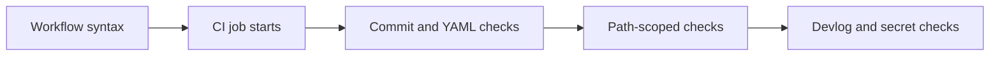

# CI and Runtime Troubleshooting

## Goal
Provide durable symptom-to-fix guidance for the process-scaffold failures that future MiniShop pull requests could repeat.

## Prerequisites
- Access to the pull request’s `ci` check and its failed-step logs.
- [Git workflow](./process/git-workflow.md) for the expected delivery sequence.

## Key Concepts
| Concept | Plain-language explanation |
|---|---|
| Job creation | A workflow syntax failure can stop GitHub Actions before any job exists. |
| Synthetic merge commit | GitHub can create a temporary merge ref for a PR; commitlint should check the actual branch commits instead. |
| Hosted runner | A runner image is not a contract that every convenience tool is installed. |
| Git ref write denial | A filesystem sandbox can block local branch creation even when the repository worktree is writable. |
| Runtime credential guard | A bootstrap script can stop before creating a Secret when a required runtime input is absent. |
| Dynamic ShellCheck source | A dynamically resolved shell helper may need an explicit source directive or scoped suppression. |
| GHCR package access | Package visibility and repository access permissions need verification after first publication. |
| NetworkPolicy enforcement | A cluster may accept NetworkPolicy objects without enforcing them if its CNI does not implement policy enforcement. |
| HPA selector overlap | A workload can match more than one HPA selector, making scaling ambiguous even when resource names differ. |
| Kustomize source paths | A base that reuses manifests outside its directory needs an explicit load-restriction choice. |
| Overlay replica targets | An HPA may set a live replica count above the replica value rendered by an overlay. |
| Kind runtime recovery | A transient container-runtime sandbox failure can leave a workload Pod Pending during a Helm reinstall. |
| Application database authentication | An HTTP-success response can still carry a database error instead of application data. |

## Architecture / Flow
A pull request first loads its workflow, then starts the `ci` job, then runs each validation step.



## Implementation Walkthrough
1. **Record workflow bootstrap failures**: capture the exact failure class before changing CI.
   - File(s): `.github/workflows/ci.yml`
   - A run with no job generally indicates a workflow-loading issue rather than a failed step.
2. **Use portable, pinned checks**: configuration belongs in the repository; runner tools are used only when explicitly available.
   - File(s): `.commitlintrc.json`, `.github/workflows/ci.yml`
   - The remediation pins kubeconform and PSScriptAnalyzer, collects PowerShell findings before failing, and replaces `rg` with `grep -E`.

## Run & Verify
```bash
# Open the failed `ci` run and identify whether a job was created.
# Read the named failed step before changing the workflow.
```
Expected result: the diagnosis identifies the failing layer and the next run advances beyond that layer. The clean-history remediation PR #7 completed successfully in GitHub Actions run `36256218460`; the earlier PR #6 run remains historical troubleshooting evidence.

## Common Pitfalls
- **Symptom:** A workflow run fails before any job begins. **Cause:** workflow YAML or expression syntax is invalid. **Fix:** correct the reported line, then confirm the next run creates `ci`.
- **Symptom:** Commitlint reports `empty-rules`. **Cause:** the CLI has no repository rule configuration. **Fix:** add and version a commitlint configuration, then lint the actual PR commit range.
- **Symptom:** Commitlint rejects a subject containing uppercase letters. **Cause:** repository policy requires a lowercase subject. **Fix:** use lowercase words and acronyms in the Conventional Commit subject.
- **Symptom:** Yamllint reports document-start, truthy-key, or line-length violations. **Cause:** the workflow does not meet the repository’s lint policy. **Fix:** make the YAML conform exactly and rerun the pinned linter.
- **Symptom:** CI cannot find `rg`. **Cause:** ripgrep is not guaranteed on a hosted runner. **Fix:** use `grep -E` for this simple changed-path filter or provision the dependency explicitly.
- **Symptom:** A local Git branch command reports a read-only ref filesystem. **Cause:** not recorded; the command could not write under `.git/refs`. **Fix:** report the exact command and obtain owner authorization before using an approved remote fallback; do not bypass the denial.
- **Symptom:** A local-path PVC remains unbound before a consumer Pod is scheduled. **Cause:** the configured `StorageClass` uses `WaitForFirstConsumer` to select a node before creating node-local storage. **Fix:** create or schedule the consumer Pod, then inspect the PVC and provisioner rollout.
- **Symptom:** A pinned containerized linter image cannot be pulled. **Cause:** the selected image tag does not exist. **Fix:** use an available, explicitly versioned image tag and record it in the validation evidence; do not install a host tool as a substitute.
- **Symptom:** The runtime credential script exits before creating the data Secret. **Cause:** one or both required runtime password inputs are absent. **Fix:** supply both required values through the deployer's runtime environment, then rerun the script; never add those values to tracked files.
- **Symptom:** ShellCheck reports `SC1091` for a helper sourced through a computed path. **Cause:** static analysis cannot resolve that dynamic source path. **Fix:** add a precise source directive when possible, or use a scoped suppression only for the dynamic source after validating the helper locally.
- **Symptom:** A fresh cluster cannot pull the published backend image. **Cause:** Package visibility or repository access permissions do not allow the intended consumers. **Fix:** verify both settings after the first protected-main publication and adjust only when needed; the workflow does not change package access.
- **Symptom:** A denied-path probe still reaches a selected Pod after NetworkPolicies apply. **Cause:** the active CNI may not enforce Kubernetes NetworkPolicy; this occurred with the local Kind `kindnet` cluster. **Fix:** verify which CNI is active and test enforcement on a policy-capable CNI before treating a successful API apply as proof that traffic is denied.
- **Symptom:** An HPA reports `AmbiguousSelector` or fails to calculate metrics for its target. **Cause:** its target Pods also match another HPA's selector; distinct HPA and Deployment names do not prevent selector overlap. **Fix:** compare each HPA target's Deployment selector and selected Pod labels, then give the new workload a disjoint selector and align its Service, NetworkPolicy, and ServiceMonitor selectors. Changing a Deployment selector is immutable; plan a controlled recreation of only that Deployment and verify legacy workloads remain unchanged.
- **Symptom:** The platform deploy script stops with `Missing required command: helm`. **Cause:** Helm is not available on the host `PATH`; `scripts/deploy-platform.sh` requires both `helm` and `kubectl`. **Fix:** use an approved pinned Helm version or provide a documented containerized invocation, then run the full script and verify the existing release is preserved. Testing chart operations in a container does not by itself validate the complete script end to end.
- **Symptom:** Kustomize cannot load canonical manifests referenced outside the base directory. **Cause:** the default `LoadRestrictionsRootOnly` disallows files outside the Kustomization root. **Fix:** when references are explicit local repository files and no plugins or remote sources are involved, render with `--load-restrictor LoadRestrictionsNone`; validate the output before applying it.
- **Symptom:** A dev overlay renders one backend replica but the running Deployment has more. **Cause:** an active HPA can override the Deployment's requested replica count to satisfy its minimum. **Fix:** inspect the target HPA's `minReplicas` and status, then distinguish the overlay's desired value from the live count; do not disable or modify the HPA implicitly.
- **Symptom:** A Helm reinstall is delayed by a Pending Pod during a transient Kind/containerd sandbox issue. **Cause:** not recorded. **Fix:** inspect Pod status/events and wait for the workload to recover; do not restart a node by default. If one non-running Pod remains after recovery, confirm it belongs to the Helm-managed controller before deleting only that Pod, then verify its replacement and all workload rollouts become Ready.
- **Symptom:** `GET /items?q=` returns HTTP 200 but the response contains
  PostgreSQL error code `28P01` instead of item data. **Cause:** the response
  reports a database authentication failure. In the case Issue #32 recorded, the
  PostgreSQL password was persisted in the PVC, so later Secret changes did not
  apply to the existing role. **Fix:** treat the endpoint as unsuccessful for
  data-path validation, avoid displaying credential values or database records,
  and ask the credential owner to align the role password. Do not delete the PVC
  or alter credentials outside an approved scope. The owner resolved this case
  during Issue #36; the exact steps are not recorded.
- **Symptom:** `GET /items?q=` returns HTTP 500 with code `42P01`, and the
  reviews route returns an empty object. **Cause:** the `marketitems` table and
  Redis keys were never seeded. **Fix:** run `bash scripts/validate-app.sh`,
  which calls `POST /upload` for this form only, or call `POST /upload` directly;
  it loads 100 rows and 100 keys. Images older than #39 answered 200 with
  `42P01`; the validator now fails on that form without uploading, which means
  an old image is still deployed.
- **Symptom (historical, images before `sha256:44a87d71...d7af`):**
  `POST /upload` crashed the backend container with a `TypeError` such as
  `"arguments[1]" must be of type "string | Buffer"`. **Cause:** node-redis
  6.2.1 rejected numeric keys. **Fix:** fixed in #43 by converting keys with
  `String(...)`; deploy the current pin.
- **Symptom (historical, images before #39):** the backend exited with code 255
  and logged `error on postgresql pool` after PostgreSQL stopped, or an upload
  waited about 64-67 s when the Redis host no longer resolved. **Cause:**
  `pool.on("error")` called `process.exit(-1)`, and Redis waits were unbounded.
  **Fix:** fixed in #39; the handler now logs `idle postgresql client error; the
  pool discarded it` and Redis waits are bounded to about 2 s. Deploy the current
  pin.
- **Symptom:** `/items`, the reviews route, or `POST /upload` returns 503 or 500
  with a JSON body such as `{"error":"Items query failed","code":"57P01"}`, or
  backend Pods turn unready. **Cause:** 503 means PostgreSQL or Redis is
  unreachable, refusing service (for example a wrong password), or timed out; 500
  is any other failure, such as `42P01` before seeding. `code` appears only for a
  PostgreSQL SQLSTATE. The readiness probe calls `GET /ready`, so a dependency
  outage removes every Pod from the Service. **Fix:** check the dependency and
  `GET /ready`, which names the failing check; `GET /live` stays 200 and Pods are
  not restarted. Waits are bounded by `REDIS_CONNECT_TIMEOUT_MS` (2000 ms),
  `REDIS_COMMAND_TIMEOUT_MS` (2000 ms), `POSTGRES_QUERY_TIMEOUT` (5000 ms), and
  `READINESS_TIMEOUT_MS` (2000 ms). In Docker tests, `/ready` once reported Redis
  when only PostgreSQL was stopped, because slow DNS failures held the libuv
  threadpool; treat the per-check detail as a hint.
- **Symptom:** backend Pods fail their probes with 404 on `/live` or `/ready`.
  **Cause:** the running image predates #46; `sha256:44a87d71...` has no health
  routes. **Fix:** deploy from `main` (`helm upgrade`) so the Deployment runs
  `sha256:599480a8...5114`. The probe paths and the pin ship together in #47.
- **Symptom:** a Docker health test gets an nginx 404 on port 80 instead of a
  backend response. **Cause:** the test read the backend's published port as
  empty and fell through to another service on port 80. **Fix:** call the backend
  from a client container on the same Docker network. Seen during Issue #47; no
  product defect.
- **Symptom:** `kubectl exec deployment/minishop-frontend` or a validator result
  comes from a legacy `frontend-*` Pod. **Cause:** the `minishop-frontend` Service and Deployment
  selectors use only `component=frontend` and `name=minishop`, which legacy
  frontend Pods also carry; only `part-of=minishop` separates them. **Fix:**
  resolve the Pod with all three labels and target `pod/<name>`. This is a
  workaround: the selectors remain unchanged, and a Deployment selector is
  immutable, so narrowing it needs a planned change.
- **Symptom:** A command run as `wsl.exe ... bash -lc '...'` reports
  `context "kind-learn" does not exist` or shows an empty variable. **Cause:** the
  outer shell expanded `$` expressions before the inner bash ran. **Fix:** keep any
  WSL command containing `$` in a script file and run that file.

## Try It Yourself
- Make a temporary Draft PR with a non-trivial change and no devlog; confirm the `ci` job reaches the devlog gate after earlier checks pass.

## Further Reading
- [GitHub Actions workflow syntax](https://docs.github.com/en/actions/reference/workflows-and-actions/workflow-syntax)
- [Commitlint getting started](https://commitlint.js.org/guides/getting-started.html)

## Related Docs
- Previous: [Process-controls remediation record](./devlog/2026-09-26-process-controls-remediation.md)
- Next: [Agent workflow governance](./devlog/2026-09-27-agent-workflow-governance.md)
- [Issue #26 platform record](./devlog/2026-09-27-platform-rbac-scaling-observability.md)
- [Issue #28 Kustomize packaging record](./devlog/2026-09-28-kustomize-packaging.md)
- [Issue #30 Helm packaging record](./devlog/2026-09-28-helm-packaging.md)
- [Issue #32 pod recovery and persistent data record](./devlog/2026-09-28-pod-recovery-data-persistence.md)
- [Issue #36 item seeding record](./devlog/2026-11-02-minishop-item-seeding.md)
- [Issue #44 backend digest pin record](./devlog/2026-11-02-backend-digest-pin.md)
- [Issue #39 backend failure handling record](./devlog/2026-11-07-backend-failure-handling.md)
